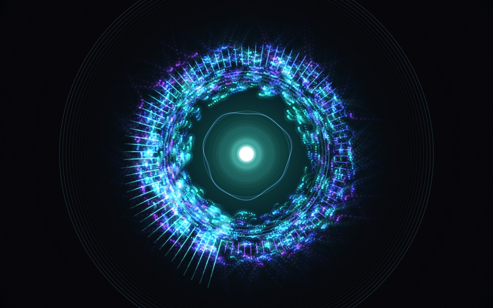
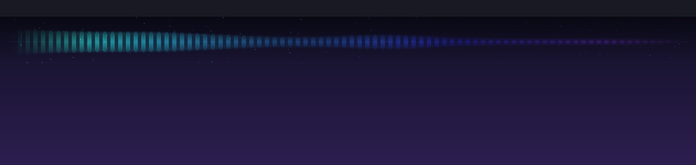
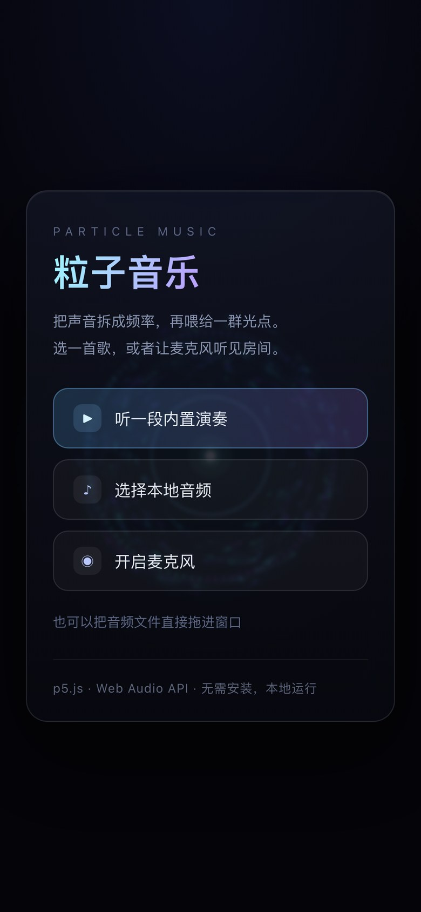

# 粒子音乐 · Particle Music

把一首歌拆成频率，再喂给一千多个光点。没有后端、没有构建步骤，双击就能跑的
声音可视化小玩具。



## 两个版本

- **网页版**：粒子多、画面大，适合全屏看，就是下面这些说明。
- **macOS 桌面版**：原生菜单栏小工具，透明置顶横条，只留少量光点，跟着系统声音跳动，
  不挡鼠标。见 [native/README.md](native/README.md)。



### 直接下载

去 [Releases](https://github.com/aLIZELI/particle-music/releases) 下载最新的
`ParticleBar-0.1.0.zip`，解压后把 `ParticleBar.app` 拖进 `/Applications` 就能用。
包是 **Apple Silicon + Intel 通用**，要求 macOS 14+。

这个包没有 Apple Developer ID 签名和公证，首次打开会被 Gatekeeper 拦下来。
两种办法任选：

- 右键点 App →「打开」→ 再点一次「打开」；
- 或者终端执行：

```bash
xattr -dr com.apple.quarantine /Applications/ParticleBar.app
```

打开后点菜单栏的波形图标 →「音源」→「系统声音」，按提示授予
「屏幕与系统音频录制」权限即可。

### 从源码构建

```bash
cd native && ./build.sh && open build/ParticleBar.app
```

发 Release 用的通用包：`./build.sh --universal`。

## 快速开始

**最简单**：直接用 Chrome / Edge / Safari 打开 `index.html`，点「听一段内置演奏」。

**要用麦克风**（推荐起个本地服务器，否则部分浏览器会拒绝麦克风权限）：

```bash
cd 粒子音乐
python3 -m http.server 8000
# 浏览器打开 http://localhost:8000
```

不需要 `npm install`，p5.js 已经放在 `vendor/` 里，离线也能跑。

## 三种音源

| 音源 | 说明 |
| --- | --- |
| 内置演奏 | 一段程序生成的 96 BPM 循环，不依赖任何音频文件，打开就能看效果 |
| 本地音频 | 选择 mp3 / wav / m4a 等文件，自动循环播放；也可以直接把文件拖进窗口 |
| 麦克风 | 对着说话、放歌、敲桌子，粒子都会跟着动 |

## 操作

手机端也能用（同样需要先点一下按钮才出声）：



| 操作 | 效果 |
| --- | --- |
| 空格 | 暂停 / 继续 |
| 1 – 4 | 切换配色（极光 / 熔岩 / 霓虹 / 深海） |
| 鼠标移动 | 把粒子吸过来 |
| 点一下画面 | 在点击处炸开一簇火花 |
| S | 保存当前画面为 PNG |
| F | 全屏 |
| H | 隐藏 / 显示界面 |
| 拖拽音频文件 | 直接换歌 |

工具栏右上角也有对应的按钮。

## 它是怎么工作的

```
麦克风 / 音频文件 / 内置合成
        │
        ▼
  AudioContext ── AnalyserNode ──► 每帧读取
        │                          ├─ 频谱 96 根（对数分布 36Hz–17kHz）
        │                          ├─ 波形 256 点
        │                          └─ 低/中/高频能量 + RMS
        ▼
     p5.js 画布
        ├─ 频谱柱：绕成一圈，低音在正下方
        ├─ 粒子：轨道弹簧 + 噪声流场 + 节拍冲击，亮度跟对应角度的频谱柱联动
        ├─ 波形：内圈一条随声音起伏的曲线
        ├─ 冲击波：检测到鼓点时向外扩散的圆环
        └─ 拖尾：每帧盖一层半透明底色，留下光轨
```

几个关键点：

- **不用 p5.sound**，直接用原生 Web Audio API。少一层依赖，也方便把同一份
  `AnalyserNode` 数据同时喂给频谱、粒子和节拍检测。
- **对数频谱**：96 根柱子按 `36Hz × (17kHz/36Hz)^(i/96)` 取频段，低频不会挤成一根。
- **节拍检测**：低音能量超过「缓慢平均值 × 1.32」且距上次鼓点超过 150ms 时，
  触发一次冲击波，避免连续误触。
- **粒子与频谱同源**：每个粒子按自己的角度找到对应的频谱柱，柱子越高，粒子越亮越大，
  所以画面里的明暗和声音是对得上的。
- **两种混合模式**：背景用普通混合做拖尾，光点用加色混合（ADD），叠得越多越亮。

## 目录

```
粒子音乐/
├── index.html            页面结构与启动遮罩
├── css/style.css         界面样式（启动页、工具栏、提示）
├── js/
│   ├── audio-engine.js   Web Audio：三种音源、FFT、内置演奏合成器
│   ├── particles.js      粒子 / 火花 / 冲击波
│   └── sketch.js         p5 主循环、绘制、交互
├── vendor/p5.min.js      p5.js 1.9.4（本地化，离线可用）
├── docs/                 预览图
└── README.md
```

## 想改着玩

大部分观感参数集中在三处：

- `js/sketch.js` 顶部的 `CFG`：拖尾长度（`trail` 越小拖尾越长）。
- `js/sketch.js` 的 `PALETTES`：每套配色的起止色相和背景色。
- `js/particles.js` 的 `ParticleField.layout()`：`r0` 决定整体大小，
  `w*h/1200` 决定粒子数量；`Particle.update()` 里能调旋转、抖动、冲击力度。

音频侧：`js/audio-engine.js` 里的 `DEMO` 节奏型、`read()` 中的频段增益，
以及 `analyser.fftSize` / `smoothingTimeConstant`。

## 调试参数

- `index.html?fake=1`：不发声，用程序生成的假频谱驱动画面，方便截图和调视觉。
- `index.html?demo=1`：自动开始内置演奏（浏览器可能拦截自动播放，需要手动点一次）。
- 控制台里的 `window.__pm` 可以取到 `state`、`engine`，也能直接 `__pm.setPalette(1)`，
  调视觉参数时比改代码刷新快。

## 已知限制

- 音频格式能否解码取决于浏览器；mp3 / wav / m4a 一般没问题，flac 看内核。
- 用 `file://` 直接打开时，Chrome 可能拒绝麦克风；用上面的本地服务器即可。
- 手机浏览器必须点一下按钮才会出声，这是系统的自动播放限制。
- 4K 屏 + 大窗口下粒子会自动降载，如果仍觉得卡，把 `particles.js` 里的
  `w*h/1200` 改小。

## 下一步可以加的东西

- 画面右下角加一个参数面板，实时调粒子数、力度、拖尾
- 用 `canvas.captureStream()` + `MediaRecorder` 录一段 WebM
- 把当前参数编码进 URL，做成「分享这个效果」的链接
- 换成 WEBGL 着色器版本，粒子数量可以上十万
- 接 MIDI 键盘 / 打击垫
- 做成桌面屏保或菜单栏小挂件

## License

[MIT](LICENSE) © 2026 aLIZELI

意思是：你可以随便用、改、再发布，保留版权声明即可；作者不对使用后果负责。
