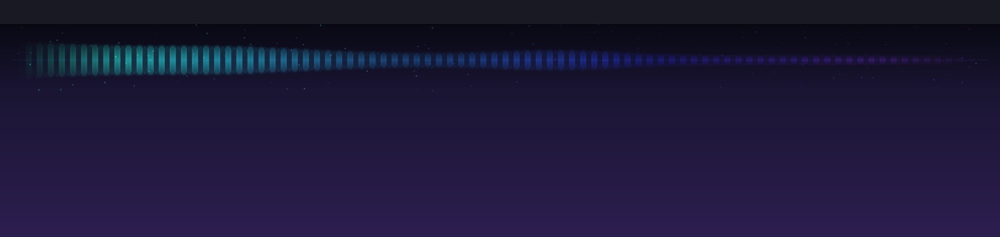

# ParticleBar · 粒子音乐条（macOS）

置顶在屏幕顶部的半透明横条，跟着系统里播放的声音跳动。原生 Swift + AppKit +
ScreenCaptureKit + Accelerate，没有 Electron，也不用装 BlackHole 之类的虚拟声卡。



## 下载

不自己编译的话，去 [Releases](https://github.com/aLIZELI/particle-music/releases)
下载 `ParticleBar-0.1.0.zip`，解压后把 `ParticleBar.app` 拖进 `/Applications`。

未公证的 App 首次打开会被 Gatekeeper 拦住：

```bash
# 方法一：右键 App → 打开 → 再点“打开”
# 方法二：
xattr -dr com.apple.quarantine /Applications/ParticleBar.app
```

## 构建和运行

需要 macOS 14+，以及 Xcode 命令行工具（`xcode-select --install`）。

```bash
cd native
./build.sh              # 只构建当前架构
./build.sh --universal  # Apple Silicon + Intel 通用包
open build/ParticleBar.app
```

首次启动，macOS 会请求「屏幕与系统音频录制」权限：

> 系统设置 → 隐私与安全性 → 屏幕与系统音频录制 → 勾选 ParticleBar

授权后如果画面还没动，点菜单栏的波形图标 →「重新连接音频」；还不行动就退出重开一次。
想改用麦克风的话，在「音源」里切到「麦克风」，会再弹一次麦克风权限。

## 菜单栏里有什么

| 菜单 | 说明 |
| --- | --- |
| 显示 / 隐藏光条 | 临时让横条消失，进程继续跑 |
| 音源 | 系统声音 / 麦克风 / 演示信号（不需要任何权限，用来确认渲染） |
| 配色 | 极光 / 熔岩 / 霓虹 / 深海 |
| 高度 | 80 / 110 / 140 pt |
| 不透明度 | 55% / 75% / 90% / 100% |
| 鼠标穿透 | 默认开启，横条不挡任何点击 |
| 重新连接音频 | 授权后不用重启 App，点这个重新抓 |
| 退出 | 结束进程 |

设置会存在 `UserDefaults`（`local.particlebar`），下次启动沿用。

## 它怎么工作

- **窗口**：无边框 `NSPanel`，`level = .statusBar`，`isOpaque = false`、背景透明、
  不参与窗口循环，出现在所有桌面和全屏空间，位置在菜单栏正下方，宽度铺满主屏。
- **音频**：`SCStream` 只订阅音频输出（不消费视频帧），抓系统混音并排除本 App；
  48kHz 双声道混成单声道。每 1024 个采样做一次 2048 点 FFT（Accelerate vDSP），
  映射到 96 根对数频段（36Hz–16kHz）。
- **视觉**：SwiftUI `Canvas` 60fps。横条以中线镜像、颜色沿宽度渐变、
  扫过式高光；140 个缓慢漂浮的小光点，低音把它们往上推，高频让柱顶更亮。
  静音时只剩很轻的呼吸，不抢注意力。
- **鼓点**：低音能量超过「缓慢均值 × 1.35」且距上次超过 160ms 时触发一次脉冲，
  避免连续误触。
- **隐私**：全部在内存里处理，不录音、不落盘、不联网。

## 开发 / 调试命令

```bash
# 频谱映射自检：送 100Hz / 1kHz / 8kHz 正弦，检查峰值落在哪根柱
./build/ParticleBar.app/Contents/MacOS/ParticleBar --selftest

# 离屏渲染一张横条图（不需要任何权限）
./build/ParticleBar.app/Contents/MacOS/ParticleBar \
  --snapshot /tmp/bar.png --width 1600 --height 110 --palette aurora

# 启动后 1.5 秒把真实的 NSHostingView 内容存成 PNG，然后退出
./build/ParticleBar.app/Contents/MacOS/ParticleBar --capture-live /tmp/live.png
```

`--selftest` 的输出类似：

```
✓    100 Hz → 第 18 根柱 (≈ 113 Hz) 强度 1.00   bass 0.60  mid 0.02  treble 0.00  level 0.25
✓   1000 Hz → 第 52 根柱 (≈ 978 Hz) 强度 1.00   bass 0.02  mid 0.08  treble 0.00  level 0.25
✓   8000 Hz → 第 85 根柱 (≈7957 Hz) 强度 1.00   bass 0.00  mid 0.00  treble 0.04  level 0.25
```

## 目录

```
native/
├── Package.swift
├── Sources/ParticleBar/
│   ├── main.swift                入口、自检、两种截图模式
│   ├── AppDelegate.swift         菜单栏、窗口布局、音源切换、权限提示
│   ├── OverlayPanel.swift        透明置顶窗口
│   ├── StripView.swift           SwiftUI Canvas 横条渲染
│   ├── ParticleField.swift       少量漂浮光点
│   ├── AudioAnalyzer.swift       FFT / 频段 / 鼓点 / 演示信号
│   ├── SystemAudioCapture.swift  ScreenCaptureKit
│   ├── MicCapture.swift          AVAudioEngine 麦克风
│   └── Settings.swift            配色与持久化
├── Resources/Info.plist
├── build.sh
└── README.md
```

## 已知限制

- 只支持 macOS 14+（通用包同时支持 Apple Silicon 和 Intel）；每块屏幕各显示一条光带（内容相同）。
- 系统声音抓取依赖屏幕录制权限；如果授权后仍失败，退出重开。
- 本地是 ad-hoc 签名：重新编译后二进制变化，macOS 可能要求重新授权。
  把 App 放到固定位置（比如 `/Applications`）再授权会稳定一些。
- 「演示信号」只是让画面先动起来，不是真实音频。
- 系统音量很小时横条也会变矮，这是按真实能量映射的结果。

## 下一步想法

- 在菜单里单独关闭某块屏幕
- 开机自启（SMAppService）
- 不依赖屏幕录制权限的方案：Core Audio process tap（macOS 14.4+）
- 停靠底部、竖屏、可拖拽调整位置
- 更细的节拍检测（多频段能量 + 历史峰值）
